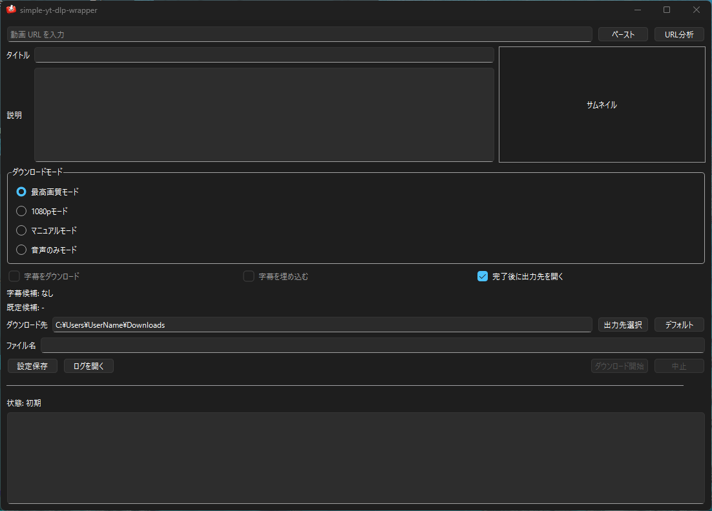

# simple-yt-dlp-wrapper

`yt-dlp` と `ffmpeg` をバックエンドに使う `PyQt6` 製の Windows 向け GUI ダウンローダです。URL を解析してメタデータと利用可能フォーマットを表示し、GUI から動画・音声・字幕をダウンロードできます。

## 主な機能

- `yt-dlp` / `ffmpeg` の依存確認
- URL 解析とメタデータ表示
- タイトル、説明、サムネイルのプレビュー
- 最高画質 / 1080p / マニュアル / 音声のみ のダウンロードモード
- 音声のみ保存時の出力形式、コーデック、サンプリングレート、ビットレート選択
- 字幕ダウンロードと埋め込みの基本対応
- 保存先やモードの設定保存、出力先フォルダを直接開く操作
- ログ出力

## 動作環境

- Windows
- `yt-dlp`
- `ffmpeg`

`yt-dlp` と `ffmpeg` は次のいずれかで利用できます。

- `PATH` に通す
- アプリ実行ファイルと同じディレクトリに `yt-dlp.exe` / `ffmpeg.exe` を置く

## リリースバイナリの利用

配布版の `exe` を使うだけなら Python のインストールは不要です。`yt-dlp.exe` と `ffmpeg.exe` は次のいずれかで配置してください。

- `PATH` に通す
- アプリ実行ファイルと同じディレクトリに置く

リリースバイナリは `dist/simple-yt-dlp-wrapper/` 配下の成果物をそのまま使えます。

## 開発時のセットアップ

具体的な手順・構成・知見は [findings.md](<findings.md#readme-4>) に移動しました。着手前に該当条件を確認してください。

## 開発時の起動

具体的な手順・構成・知見は [findings.md](<findings.md#readme-5>) に移動しました。着手前に該当条件を確認してください。

## EXE ビルド

具体的な手順・構成・知見は [findings.md](<findings.md#readme-6>) に移動しました。着手前に該当条件を確認してください。

## CI / CD

具体的な手順・構成・知見は [findings.md](<findings.md#readme-7>) に移動しました。着手前に該当条件を確認してください。

## プロジェクト構成

具体的な手順・構成・知見は [findings.md](<findings.md#readme-8>) に移動しました。着手前に該当条件を確認してください。

## ライセンス

MIT License。詳細は [LICENSE](LICENSE) を参照してください。

## 依存更新の自動処理

具体的な手順・構成・知見は [findings.md](<findings.md#readme-10>) に移動しました。着手前に該当条件を確認してください。
